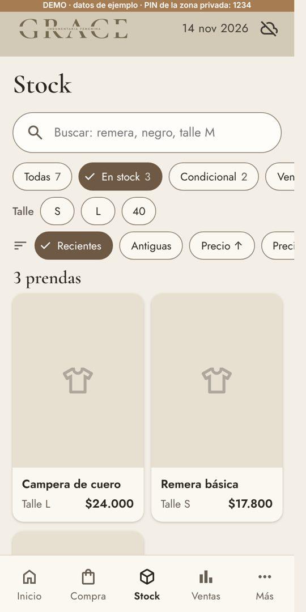
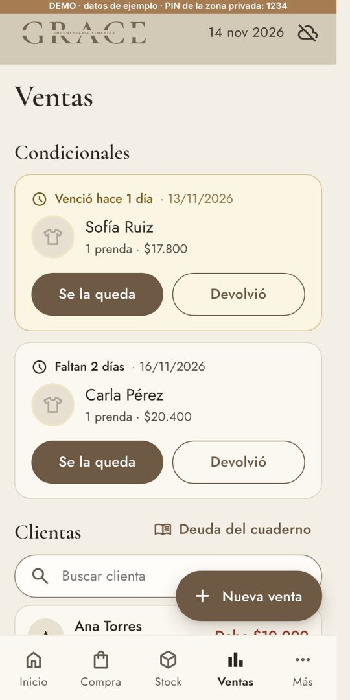

# Grace Indumentarias · App de gestión comercial

[](https://TU-DEMO.netlify.app)


App web instalable (PWA) para celular que gestiona un negocio real de reventa de ropa: compras por lote, stock con fotos, ventas, pagos, clientas, deudas y balance. Funciona **sin internet** y se sincroniza entre dispositivos cuando hay conexión.

> **Probala:** [TU-DEMO.netlify.app](https://TU-DEMO.netlify.app) · La demo usa **datos inventados** y no se conecta a ninguna base de datos: podés tocar todo sin romper nada. PIN de la zona privada: `1234`.

<p align="center">
  
  
  
</p>

## El problema

La dueña del negocio compra ropa en Chile (en pesos chilenos), la vende en Argentina (en pesos argentinos) y lleva las cuentas en un cuaderno. Necesitaba saber cuánto le costó cada prenda en su moneda, cuánto ganó de verdad y quién le debe, desde el celular, con letra grande y sin complicaciones, y sin que las clientas vean sus costos si les muestra el teléfono.

## Qué hace

- **Compras por lote:** carga el lote, saca fotos, pone precios y revisa la cuenta con la cotización del momento.
- **Stock con fotos:** buscador, filtros, orden y ficha de cada prenda (en stock, condicional o vendida).
- **Ventas, pagos y deudas:** ventas normales y condicionales, pagos parciales, devoluciones y deudas anteriores del cuaderno.
- **Multimoneda:** costos y ganancias entre pesos chilenos (CLP), pesos argentinos (ARS) y dólares (USD).
- **Zona privada con PIN:** costos, ganancias, inversión y balance quedan ocultos por defecto.
- **Exportación a Excel** de estados de cuenta.
- **Modo claro y oscuro**, diseño Material 3 pensado para una persona poco tecnológica.

## Cómo está armada

```
 Celular / navegador                                  Nube (Supabase)
┌─────────────────────────────┐   sincroniza   ┌──────────────────────────────┐
│ React 18 + Vite (PWA)       │ ─────────────► │ PostgreSQL (tablas           │
│ Service Worker (Workbox)    │ ◄───────────── │ normalizadas + migraciones)  │
│ localStorage  → registros   │  tiempo real   │ Row Level Security (RLS)     │
│ IndexedDB     → fotos       │                │ Auth (email y contraseña)    │
└─────────────────────────────┘                │ Storage privado (fotos)      │
                                               └──────────────────────────────┘
```

### Decisiones técnicas

- **Offline-first:** la app lee y escribe primero en el dispositivo; la nube es una copia que se sincroniza. Cada registro lleva su fecha de modificación y, si dos dispositivos tocan lo mismo, gana el cambio más nuevo. Los borrados viajan como marcas para que se propaguen a los demás dispositivos.
- **Seguridad en la base, no en la pantalla:** los datos solo los entrega Supabase a usuarios autenticados, con políticas RLS; la app además exige sesión y cierra todo al vencer. Las fotos van a un almacenamiento privado.
- **Base normalizada con migraciones SQL versionadas** e idempotentes, que se corren antes de publicar cada cambio de esquema.
- **Pantallas como piezas chicas y probables:** cada pantalla es un módulo, los textos que vienen de los datos se escapan siempre y un `ErrorBoundary` evita pantallas en blanco.
- **Pruebas automáticas** que usan la app como una persona (tocan botones por su texto, escriben en campos y miran la pantalla), con un Supabase de mentira para cubrir sesión vencida, sin internet y sincronización.
- **Demo segura por construcción:** se compila aparte con una variable de entorno; esa versión ni siquiera lleva las claves de la base y todos los datos viven solo en memoria.

## Stack

| Área | Tecnologías |
|---|---|
| Interfaz | React 18, Vite, JavaScript (ES6+), HTML5, CSS3 (Material Design 3) |
| Datos | Supabase, PostgreSQL, SQL, RLS, Supabase Storage |
| Sin conexión | PWA, Service Worker (Workbox), IndexedDB, localStorage |
| Calidad | Vitest (más de 30 archivos de prueba), ESLint, Prettier |
| Entrega | Git y GitHub (ramas main / develop / feature), Netlify |
| Extras | ExcelJS (exportación a Excel) |

## Sobre el código

El proyecto está en producción y lo usa un negocio real, así que el código fuente se mantiene en un repositorio privado. Si querés verlo (por una vacante o un proyecto), escribime y te doy acceso o lo recorremos juntos en una videollamada.

## Autor

**Matías Marco Galli** · Estudiante avanzado de Ingeniería en Sistemas (UTN FRC) · Río Tercero, Córdoba, Argentina
[LinkedIn](https://linkedin.com/in/galli-matias-marco) · [Portfolio](https://TU-PORTFOLIO.netlify.app) · matiasgalli20@gmail.com

## Licencia

Todos los derechos reservados. Ver [LICENSE](LICENSE).